<p align="center">
  
</p>

<p align="center">
  <a href="https://www.linkedin.com/in/ashifreza/"></a>
  <a href="mailto:ashifcse247@gmail.com"></a>
  
</p>

<p align="center">
  
</p>

---

### `$ npx wdio run ./ashif-reza.conf.ts`

<p align="center">
  
</p>

I'm an **SQA Engineer II at [Pathao](https://pathao.com)** with 3+ years of testing web and mobile products end to end. I build **iOS automation frameworks with WebdriverIO + Appium**, own the testing lifecycle from PRD review to release sign-off, and mentor junior QA engineers. I care about fast feedback, readable test code and not shipping bugs.

---

## 🧪 Test Plan: what I bring

| Area | Coverage |
|---|---|
| 📱 **Mobile automation** | iOS framework design with WebdriverIO (Appium) and Page Object Model, BDD suites, parallel runs on BrowserStack, Android + iOS cross-platform testing |
| 🌐 **Web automation** | Playwright and Selenium end-to-end suites |
| 🔌 **API testing** | Postman collections, contract checks against API docs, workflow automation with Python + Postman |
| ⚡ **Performance** | Load and stress testing with JMeter |
| 🧭 **QA process** | PRD analysis, test plans, test case design and review, regression strategy, root-cause analysis, bug triage with developers |
| 🤖 **AI-assisted QA** | Speeding up automation work with Cursor and MCP |

---

## 🧰 Toolbox

**Automation**<br/>


**API & performance**<br/>


**Languages**<br/>


**Workflow**<br/>


---

## 📋 Changelog: career releases

```diff
+ v3.0.0  SQA Engineer II · Pathao                              Jan 2026 → present
+         Leads functional, regression and API testing; mentors junior QA engineers;
+         building the iOS automation framework (WebdriverIO + Appium, POM)

+ v2.0.0  SQA Engineer I · Pathao                               Oct 2024 → Jan 2026
+         iOS automation with Appium (BDD); parallel device runs on BrowserStack;
+         automation improvements with Cursor + MCP

+ v1.1.0  SQA Engineer · mPower Social Enterprises              Jul 2023 → Oct 2024
+         Health, agriculture and education apps; Appium mobile automation;
+         Playwright web automation; JMeter load testing

+ v1.0.0  SQA Engineer (Intern) · XpeedStudio                   Mar 2023 → Jul 2023
+         Manual testing, bug reports, Postman API scripts, Playwright

! v0.x    B.Sc. in CSE · Ahsanullah University of Science & Technology  2018 → 2022
```

---

## 🔬 Featured test suites

| Suite | Type | Stack |
|---|---|---|
| [appiumAutomate](https://github.com/ashifReza/appiumAutomate) | 📱 Mobile E2E with reporting | Appium · Java |
| [smarthealth-automate](https://github.com/ashifReza/smarthealth-automate) | 🏥 Health platform automation | Automation |
| [smartCareProAutomate](https://github.com/ashifReza/smartCareProAutomate) | 🏥 Health platform automation | JavaScript |
| [swaglabs-login-to-CompleteBuy-automation](https://github.com/ashifReza/swaglabs-login-to-CompleteBuy-automation) | 🛒 E-commerce checkout flow | Selenium · Java |
| [simplebookapi-apiTesting-postman](https://github.com/ashifReza/simplebookapi-apiTesting-postman) | 🔌 REST API testing | Postman |
| [twitch-load-testing-using-jmeter](https://github.com/ashifReza/twitch-load-testing-using-jmeter) | ⚡ Load testing | JMeter |
| [vimeo-SignUp-Module-testCases](https://github.com/ashifReza/vimeo-SignUp-Module-testCases) | 📝 Test case design | Manual QA |

**Products I've tested in production:** 🏥 Smart Health BD · 💉 Citizen Portal (Vax EPI) · 🌾 Shudokkho · 🐄 Khamar Bondhu · 🎓 Pandoo · 📚 OctaApp · 🛵 Pathao

---

## 🐞 Open issue

> **QA-2026: Looking for teams that take quality seriously**
> **Severity:** High · **Priority:** P1 · **Status:** Open
>
> **Steps to reproduce:** Read this profile → visit [LinkedIn](https://www.linkedin.com/in/ashifreza/) → send a message.
> **Expected result:** We talk about test automation, QA strategy, or your next release.
> **Actual result:** Pending your message.

---

<p align="center">
  
</p>
